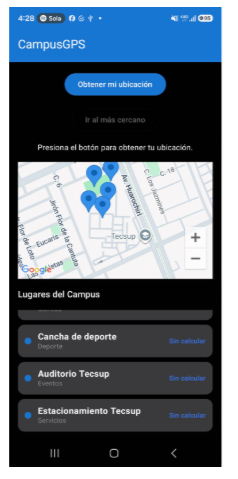
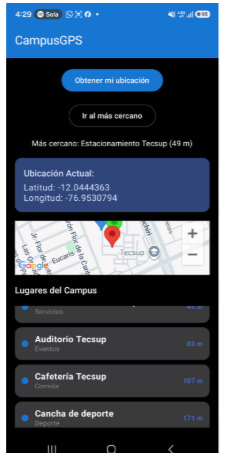
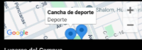

# CampusGPS

**CampusGPS** es una aplicación Android desarrollada en Kotlin utilizando **Jetpack Compose**, **Material 3** y la arquitectura **MVVM (Model-View-ViewModel)**. Permite a los usuarios ubicar en tiempo real su posición en el campus, visualizar puntos de interés en un mapa interactivo de Google Maps con marcadores personalizados, calcular distancias y determinar el lugar más cercano dentro del campus Tecsup Lima.

---

## Capturas de Pantalla

| Mapa Inicial | Ubicación y Más Cercano | Marcador Seleccionado |
| :---: | :---: | :---: |
|  |  |  |

---

## Estratificación de Paquetes (`com.galindo.campusgps`)

```text
com.galindo.campusgps
├── MainActivity.kt
├── data
│   ├── LugaresRepository.kt
│   ├── LugaresRepositoryLocal.kt
│   ├── UbicacionRepository.kt
│   └── UbicacionRepositoryGoogle.kt
├── model
│   └── Modelos.kt
├── ui
│   ├── ListaLugares.kt
│   ├── MapaUbicacion.kt
│   ├── MensajeError.kt
│   ├── PantallaMapa.kt
│   └── theme
│       ├── Color.kt
│       ├── Theme.kt
│       └── Type.kt
├── util
│   ├── Distancia.kt
│   └── Formato.kt
└── viewmodel
    ├── CampusViewModelFactory.kt
    └── MapaViewModel.kt
```

---

## Diagrama de Arquitectura (MVVM + Repository)

```text
+-------------------------------------------------------------------------+
|                                UI Layer                                 |
|  [ PantallaMapa ] <---> [ MapaUbicacion ] | [ ListaLugares ] | [ MensajeError ] |
+------------------------------------+------------------------------------+
                                     | (Observa StateFlows / Dispara Eventos)
                                     v
+-------------------------------------------------------------------------+
|                             ViewModel Layer                             |
|                             [ MapaViewModel ]                           |
+------------------------------------+------------------------------------+
                                     | (Invoca Suspend Functions / Lógica de Negocio)
                                     v
+-------------------------------------------------------------------------+
|                            Repository Layer                             |
|    [ UbicacionRepositoryGoogle ]        |     [ LugaresRepositoryLocal ]|
+------------------------------------+------------------------------------+
                                     | (Accede a Servicios / Hardware)
                                     v
+-------------------------------------------------------------------------+
|                            Data Source Layer                            |
|     [ FusedLocationProviderClient ]     |       [ Colección de Lugares ] |
+-------------------------------------------------------------------------+
```

---

## Secciones "Para Pensar"

### 1. ¿Por qué `FusedLocationProviderClient` está dentro del Repository y no en el ViewModel?
`FusedLocationProviderClient` es un componente de bajo nivel dependiente de las APIs de Android (Google Play Services / Android SDK). Siguiendo los principios de Clean Architecture y las guías de Android, el **ViewModel** debe permanecer desacoplado de las APIs del sistema operativo para enfocarse únicamente en la lógica de presentación y la gestión del estado de la interfaz gráfica. Colocar `FusedLocationProviderClient` dentro del **Repository** abstrae la fuente de datos, facilita el mantenimiento del código y permite realizar pruebas unitarias del ViewModel mediante dobles de prueba (mocks).

### 2. ¿Qué diferencia hay entre el permiso de ubicación y la clave de API de Maps? ¿Qué pasa si falta cada uno?
- **Permiso de ubicación (`ACCESS_FINE_LOCATION` / `ACCESS_COARSE_LOCATION`)**: Es una autorización otorgada por el usuario en tiempo de ejecución a nivel del sistema operativo. Si falta este permiso, la aplicación no podrá obtener las coordenadas de latitud y longitud del dispositivo, emitiendo un estado de error (`TipoError.SIN_PERMISO`).
- **Clave de API de Maps (`MAPS_API_KEY`)**: Es una credencial de autenticación emitida por Google Cloud Platform que autoriza a la app para renderizar los mapas de Google. Si falta o es incorrecta, los componentes de Google Maps mostrarán una rejilla gris o mapa en blanco, aunque la app conserve la capacidad de calcular coordenadas o distancias.

### 3. ¿Por qué la clave va en `local.properties` y no en el código? ¿Qué harías si se subiera a GitHub por error?
- La clave se almacena en `local.properties` porque este archivo está incluido en `.gitignore` y no se sincroniza con el repositorio remoto. Esto evita la exposición pública de credenciales sensibles y previene usos no autorizados de la cuota de la cuenta de Google Cloud.
- **En caso de subir la clave a GitHub por error:**
  1. Ingresar inmediatamente a la consola de **Google Cloud Platform (GCP)** y eliminar/revocar la clave expuesta.
  2. Generar una nueva API Key aplicando restricciones de seguridad (restricción por nombre de paquete `com.galindo.campusgps` y huella SHA-1 de la firma APK).
  3. Actualizar la clave localmente en el archivo `local.properties`.
  4. Eliminar el commit expuesto del historial de Git utilizando herramientas como `git filter-repo` o BFG Repo-Cleaner.

### 4. ¿Dónde calculas la distancia y por qué no en el Composable?
- La distancia se calcula en el **`MapaViewModel`** utilizando la función de utilidad `distanciaMetros` (`com.galindo.campusgps.util`).
- **No se calcula en el Composable** porque las funciones `@Composable` son puramente declarativas y se ejecutan repetidamente durante la recomposición. Realizar cálculos numéricos u operaciones intensivas en la UI degrada el rendimiento de la animación (provocando jank/lag) y viola el principio de separación de responsabilidades de MVVM. El ViewModel calcula y expone las distancias únicamente cuando cambia la ubicación.

### 5. ¿Qué pasa con tu app si el usuario niega el permiso dos veces? ¿Cómo lo manejas?
- Si el usuario niega el permiso de ubicación dos veces (o marca "No volver a preguntar"), el sistema operativo bloquea las solicitudes automáticas mediante diálogo. Al llamar a `lanzador.launch(...)`, la API responderá inmediatamente indicando que fue denegado sin mostrar interacción nativa.
- **Manejo en la App:** La denegación se captura y emite el estado `UbicacionUi.Error(..., TipoError.SIN_PERMISO)`. En la interfaz gráfica se presenta el componente `MensajeError` con el botón de acción **"Abrir ajustes"**, el cual ejecuta un `Intent(Settings.ACTION_APPLICATION_DETAILS_SETTINGS)` redirigiendo al usuario a la pantalla de configuración del sistema para que pueda otorgar el permiso manualmente.
